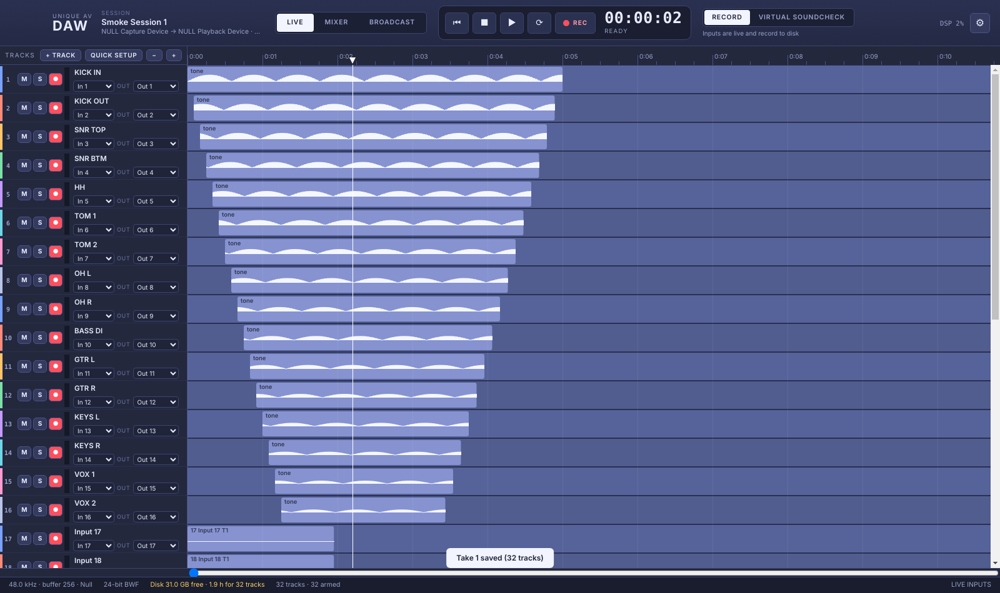
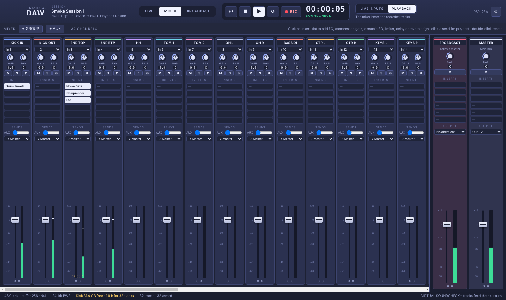
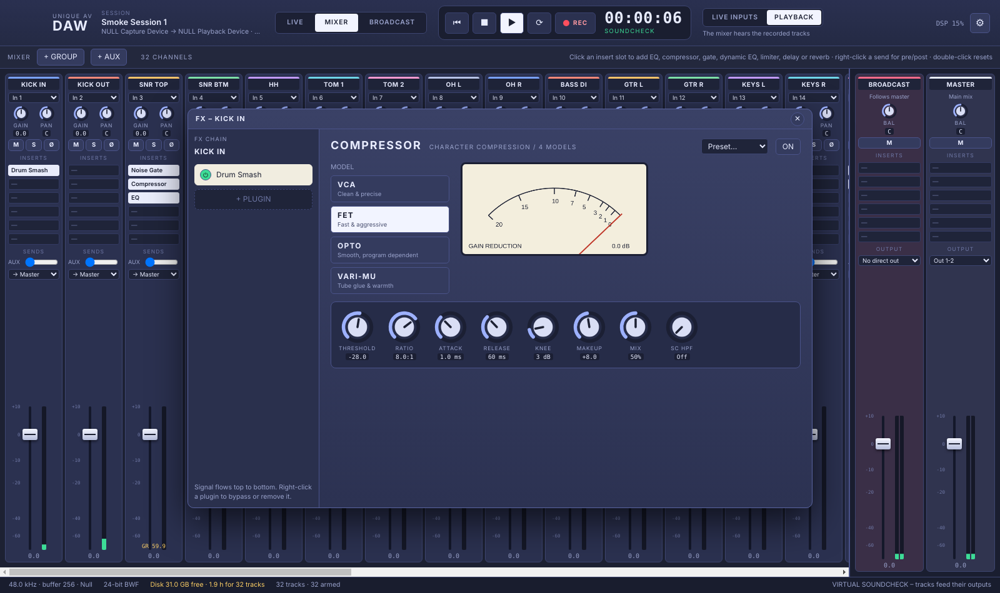
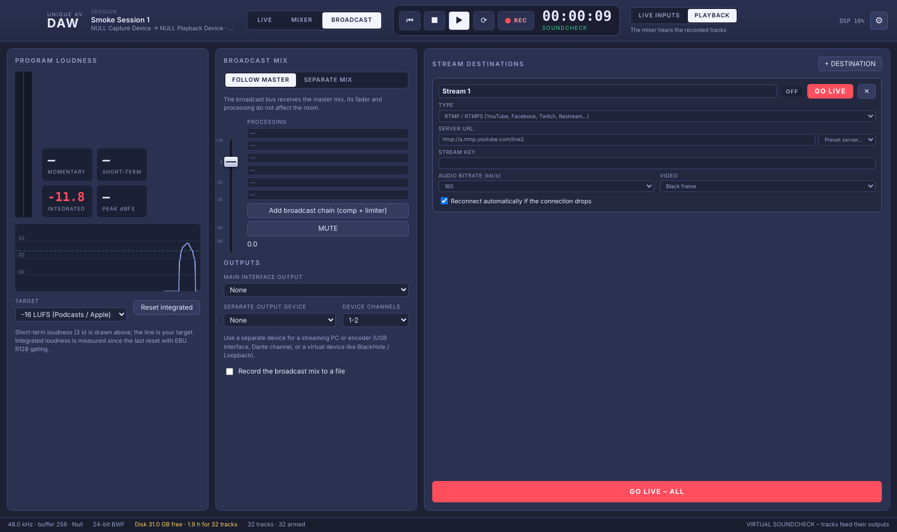

# Unique AV DAW

**Unique AV DAW** is a live-sound multitrack recorder and mixer for macOS. It has three modes:

| Mode | What it does |
|---|---|
| **LIVE** | Records every input of your console or stagebox to disk. A **RECORD / VIRTUAL SOUNDCHECK** switch sends the recorded tracks back out to the console's inputs, so you can soundcheck with the band's last show. |
| **MIXER** | Full channel strips: gain, pan, polarity, 6 insert slots, aux sends, group buses and a master. You can mix the live inputs or the recordings. |
| **BROADCAST** | A separate broadcast bus that follows the master or has its own mix. It has its own processing and EBU R128 loudness metering, and it outputs to hardware, to a second audio device, or to live streams over RTMP/RTMPS, SRT or Icecast. |



| Mixer | Compressor | Broadcast |
|---|---|---|
|  |  |  |

## Works with any Core Audio device

The audio engine is native C code built on [miniaudio](https://miniaud.io) / Core Audio. It runs up to **128 tracks** on interfaces with up to 256 channels.

* **Dante:** use Dante Virtual Soundcard (64 or 128 channels) or any Dante interface.
* **Waves SoundGrid / QRec:** choose the *SoundGrid* driver. On macOS, allow microphone access for the *SoundGrid Core Audio Service*.
* **Consoles:** USB and Thunderbolt consoles and stageboxes (Behringer X32/Wing, Midas, Allen & Heath SQ/dLive/Avantis, Yamaha, Soundcraft and others).
* **Interfaces:** MADI (RME), AVB, and USB or Thunderbolt interfaces.
* **Virtual devices:** BlackHole and Loopback, for sending audio to other apps.
* **Several devices at once:** combine them into an **Aggregate Device** in *Audio MIDI Setup* and choose that device.

Input and output can be different devices. The broadcast bus can also play out on a third device, such as a USB interface feeding a streaming PC.

## Features

### Recording (LIVE mode)
* **Quick Setup** creates one track per input. It maps input *n* to track *n* and output *n* (for virtual soundcheck), arms every track, and can replace the existing tracks.
* Every track has an input selector, a virtual-soundcheck **OUT** selector, Mute, Solo, Record arm and an input meter.
* Takes are saved as **Broadcast WAV (BWF)** files in 16-bit, 24-bit or 32-bit float. Each file's `bext` time stamp is the take's start position, so the files drop into Pro Tools, Logic, Reaper and Waves Tracks Live at the right place.
* A dedicated disk-writer thread writes the files. The file headers are refreshed every 2 seconds, so a crash or power cut still leaves usable files. The session saves itself as soon as you stop recording.
* The status bar shows free disk space, recording time left for the armed tracks, dropped samples and disk underruns. The Mac is kept awake while recording.
* Waveforms draw live while recording.
* Editing: move clips, trim clip edges, split at the playhead (**S**), delete, clip gain and clip mute. Shift-drag on the ruler sets a loop. Undo and redo are available.

### Virtual soundcheck
Flip the top switch to **VIRTUAL SOUNDCHECK**. Each track then plays back to its **OUT** channel, for example over Dante or SoundGrid into the console's inputs, and playback replaces the live inputs in the mixer. Flip back to **RECORD** to go live again.

### Mixer
Insert plugins. The **Channel Strip** preset loads a gate, compressor and EQ in one click.

| Plugin | Controls |
|---|---|
| Parametric EQ | HPF (24 dB/oct), LPF, and 4 bands (bell, shelves, notch, HP/LP) with a draggable response curve |
| Compressor | **4 models: VCA, FET, Opto, Vari-Mu**, with threshold, ratio, attack, release, knee, makeup, parallel mix, sidechain HPF and a VU gain-reduction meter |
| Noise Gate | Threshold, range, attack, hold, release, hysteresis, and key HPF/LPF |
| Dynamic EQ | Two bands that cut or boost only when their frequency band passes the threshold. The *De-esser* preset uses this plugin. |
| Limiter | Look-ahead brickwall: input gain, ceiling and release |
| Delay | Time, feedback, mix, high cut and ping-pong |
| Reverb | Size, damping, mix and width |

Other presets: Drum Smash, Vocal Leveler, Bus Glue and Broadcast Chain.

### Broadcast
* **Follow master:** the broadcast bus gets the main mix, and its fader and processing don't affect the room.
* **Separate mix:** every channel gets a BROADCAST send.
* Loudness metering shows momentary, short-term and integrated loudness and peak, with a history graph and selectable targets: -14 (streaming), -16 (podcasts), -23 (EBU R128) and -24 (ATSC). Measurement follows ITU-R BS.1770.
* Stream destinations: **RTMP/RTMPS** (with presets for YouTube, Facebook, Twitch and Restream), **SRT**, **Icecast/Shoutcast**, or any FFmpeg URL. You can stream to several destinations at once, and each one reconnects automatically if it drops.
* RTMP platforms require a video track, so the stream carries a black frame or an image you choose.
* You can record the broadcast mix to a WAV or MP3 file.

### Sessions
* Each session is a folder containing `Name.uavdaw` (JSON) and `Audio/` and `Mixdowns/` subfolders.
* Supported actions: New, Open, Open Recent, Save, Save As, templates, autosave backups, Import Audio (any format; converted with FFmpeg), and Export Mix / Export Stems to WAV (optionally also MP3). Exports run faster than real time.

### Auto-update
Installed copies check GitHub Releases every 4 hours. They download the update in the background (verified with SHA-512) and install it on the next restart. Updates never install while you are recording or streaming. *Help → Check for Updates…* shows the update status and settings.

> GitHub only serves release downloads to the app from a **public** repository. If this repository stays private, put an update URL that the app can reach in *Updates → Update URL*.

## Keyboard

| Key | Action |
|---|---|
| Space | Play / stop |
| R | Record |
| Home / Enter | Go to the start |
| L | Loop on/off |
| S | Split at the playhead |
| Backspace | Delete the selected clip |
| ⌘1 / ⌘2 / ⌘3 | Live / Mixer / Broadcast |
| ⌘ + scroll, + / − | Zoom |
| Shift + scroll | Scroll the timeline |

## Building

```bash
npm install          # also compiles the native engine (node-gyp)
npm start            # run the app
npm test             # engine, loudness and updater tests (no audio hardware needed)
npm run dist:mac     # build the .dmg and .zip
```

`UAVDAW_NULL_AUDIO=1 npm start` runs the app against a virtual 32×32 device. `test/electron-smoke.cjs` uses the same mode to test the whole app end to end.

## Releasing

Go to **Actions → Build macOS app → Run workflow** and enter a version, such as `1.0.1`. The workflow:
1. builds Apple Silicon and Intel DMGs and ZIPs,
2. publishes a GitHub Release with `update-mac.json`,
3. lets installed copies update themselves.

To sign and notarise the app, add the `MAC_CERT_P12_BASE64`, `MAC_CERT_PASSWORD`, `APPLE_ID`, `APPLE_APP_SPECIFIC_PASSWORD` and `APPLE_TEAM_ID` secrets. Without them, the app is ad-hoc signed. In that case, right-click the app and choose **Open** the first time you launch it.

## Layout

```
native/        C engine: addon.c (Node-API + device I/O), engine.c (mixer, recorder,
               disk streaming), dsp.c (plugins), wav.c (BWF read/write), vendor/miniaudio.h
main.js        Electron main process: sessions, dialogs, menus, IPC
main/          streamer.js (FFmpeg + loudness), importer.js, updater.js
src/           UI: js/timeline.js (LIVE), js/mixer.js, js/fx.js (plugins),
               js/broadcast.js, js/dialogs.js, js/state.js (model + engine sync)
test/          engine tests, loudness tests, updater tests, Electron smoke test
```
